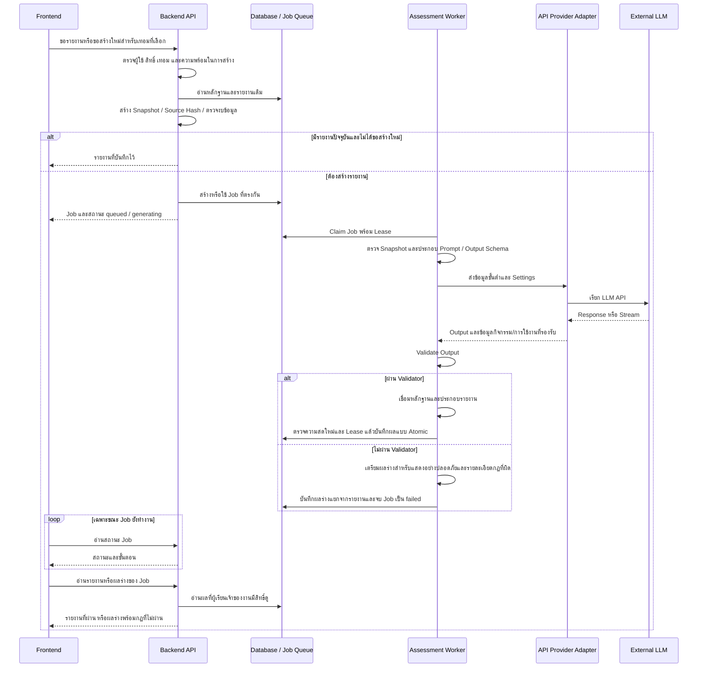

# Learner Assessment Report API LLM v1

วันที่: 2026-10-10

สถานะ: Implement ระบบเตรียม API Provider และผลร่างตามแผนแล้ว (2026-10-10) ยังไม่เรียก API จริงหรืออนุมัติใช้งานจริง ดูขั้นตอนเปิดระบบและข้อจำกัดใน `learner-assessment-report-api-llm-operations.md`

## 1. ตรวจสอบ Architecture ที่เสนอ

โครงสร้างเดิมที่เสนอ:

```text
Frontend ขอสร้างรายงาน
-> Backend สังเคราะห์ข้อมูลจาก Database
-> จัดข้อมูลสำหรับ LLM เป็น JSON
-> เรียก LLM API
-> รับ Response
-> บันทึก Database
-> แสดงบน Frontend
```

ทิศทางหลักถูกต้อง: Frontend ไม่ควรเรียกผู้ให้บริการ LLM โดยตรง และ Backend เป็นผู้ควบคุมสิทธิ์ ข้อมูล หลักฐาน และการบันทึกรายงาน แต่ยังขาดขอบเขตสำคัญ:

| จุดที่ขาด | แนวทางปรับปรุง |
|---|---|
| คำขอเว็บรอจน LLM ตอบเสร็จ | รับงานเข้าคิว ตอบสถานะให้เว็บ แล้วให้ Worker ประมวลผล |
| รับ Response แล้วบันทึกทันที | ตรวจรูปแบบ ความสอดคล้องกับหลักฐาน และข้อห้ามก่อนประกอบรายงาน |
| ส่ง Response ไปแสดงโดยตรง | แยกรายงานที่ผ่านออกจากผลร่างที่ไม่ผ่าน พร้อมแจ้งกฎที่ผิดบนเว็บ ผลร่างไม่ถือเป็นรายงานที่ยืนยันแล้ว |
| ไม่ระบุแหล่งตัดสินผลความพร้อม | Backend ตรวจเกณฑ์ด้วยกฎเดิม LLM อธิบายและเสนอการเตรียมตัว ไม่ตัดสินสิทธิ์ |
| ไม่ระบุข้อมูลเปลี่ยนระหว่างสร้าง | ตรวจ Source Hash และสิทธิ์การถือครองงานก่อนบันทึก ป้องกันผลเก่าทับผลใหม่ |
| ไม่ระบุการกดซ้ำและค่าใช้จ่าย | ใช้รายงานปัจจุบันซ้ำ รวมคำขอที่ตรงกัน และจำกัดการสร้างใหม่/Retry |
| ไม่ระบุข้อมูลผู้เรียนที่ออกนอกระบบ | ใช้ข้อมูลขั้นต่ำที่อนุญาต ตัดตัวระบุบุคคล และตรวจนโยบายผู้ให้บริการก่อนใช้งานจริง |

การจัดหลักฐานเป็น JSON เหมาะสม แต่ต้องแยก JSON ข้อมูลหลักฐานออกจาก HTTP payload ของผู้ให้บริการ ซึ่งยังมีคำสั่ง ระบบกำหนดรูปแบบ Output และ Settings การสร้างด้วย

## 2. Architecture ที่แนะนำ



เมื่อข้อมูลไม่พอ เกินงบ หรือ Provider ไม่พร้อม ให้ส่งสถานะที่อธิบายได้แทนการสร้างงานที่ไม่สามารถดำเนินการได้ หากมี Output แต่ไม่ผ่าน Validator ให้จบเป็นงานล้มเหลว และแสดงผลร่างพร้อมหมายเหตุเฉพาะเจ้าของงานตามหัวข้อ 10 ไม่ถือว่าผลร่างเป็นรายงานปัจจุบันที่ผ่านการตรวจ

## 3. ความรับผิดชอบและการใช้ระบบเดิม

### Frontend

- ส่งเฉพาะภาคเรียนและความต้องการสร้างใหม่ ไม่ส่งผลการเรียนหรือสถานะผ่านเกณฑ์มาให้ Backend เชื่อถือ
- แสดงสถานะตาม Job เช่น เข้าคิว เตรียมข้อมูล กำลังสร้าง ตรวจผล และบันทึก ใช้กลไก Progress เดิม
- Poll เฉพาะงานที่ยังทำงาน หยุดเมื่อสำเร็จ ล้มเหลว หรือถูกแทนที่ ไม่ยิงคำขอสร้างรายงานทุกครั้งที่ Poll
- ไม่ถือ API Key และไม่เรียก External LLM โดยตรง
- เมื่อ Output ไม่ผ่าน ให้แสดงผลร่างพร้อมชื่อกฎ คำอธิบาย และตำแหน่งที่ผิด ไม่แสดงเพียงข้อความรวมว่าไม่ผ่านการตรวจสอบรูปแบบ
- การส่ง Stream จาก Provider ใช้แจ้งความคืบหน้าที่ Worker ก่อน ไม่เท่ากับนำข้อความดิบไปแสดงบนเว็บทันที และไม่อ้างเปอร์เซ็นต์ความสำเร็จที่ไม่มีข้อมูลรองรับ

### Backend API และ Source Builder

- ใช้ระบบ Authentication และ Learner ownership เดิม ระบุตัวผู้เรียนจาก Session ไม่รับรหัสผู้เรียนที่ Frontend เลือกเองสำหรับ endpoint นี้
- ดึงหลักฐานตามกฎเดิม: รายวิชาและเกรดก่อนเทอมที่เลือก รวม Summer และใช้เกรดดีที่สุดในช่วงนั้น ส่วนกิจกรรมใช้ข้อมูลล่าสุดทั้งหมดตามกฎระบบ
- ผลตรวจความพร้อมมาจากตัวคำนวณเดิม ไม่ให้ LLM คำนวณ GPA ตัดสินการผ่านเกณฑ์ใหม่ หรืออนุมัติสิทธิ์ไปสหกิจ
- สร้าง Snapshot ที่อ้างอิงได้ พร้อม Source Hash และ Version ของ Provider, Model, Prompt, Schema และการเตรียมหลักฐาน
- ใช้รายงานล่าสุดของแต่ละเทอม รายงานล้าสมัยไม่เผยแพร่เป็นผลปัจจุบัน และขอสร้างใหม่ผ่านคิวตาม Flow เดิม
- ข้อมูลพร้อมบางส่วนสามารถสร้างรายงานได้โดยระบุส่วนที่ขาด แต่ไม่มีข้อมูลวิเคราะห์เลยไม่เรียก Provider

### Job Queue และ Worker

- ใช้ Job Repository, Lease, Heartbeat, Progress และการบันทึกแบบ Transaction เดิม ไม่สร้าง Queue อีกชุดในเวอร์ชั่นนี้
- คำขอที่ผู้เรียน/เทอม/Source Hash เดียวกันใช้ Active Job เดียวกัน รวมถึงคำขอจากหลายแท็บ
- ตรวจ Snapshot กับ Runtime configuration ก่อนส่ง Provider และตรวจข้อมูลปัจจุบันอีกครั้งก่อนเผยแพร่ผล
- ถ้า Snapshot ล้าสมัย หรือ Lease ไม่ใช่ของ Worker นี้แล้ว ห้ามบันทึกผลให้ทับรายงานใหม่
- การปิดหน้าเว็บไม่ใช่การยกเลิก Job โดยอัตโนมัติ ผู้เรียนกลับมาอ่านสถานะและผลได้

### Provider Adapter

- เพิ่ม API Adapter หลัง `AssessmentProvider` เดิม และรองรับ `StreamingAssessmentProvider` หากผู้ให้บริการที่เลือกมีความสามารถที่เหมาะสม
- แปลง Prompt, หลักฐาน และ Output Schema เป็นรูปแบบเฉพาะของผู้ให้บริการ โดยไม่ให้ Business Service ผูกกับ SDK หรือรูปแบบ HTTP ของรายนั้น
- แปลง Timeout, การยืนยันตัวตน, Rate Limit, Output ไม่ครบ และข้อผิดพลาดเครือข่ายเป็นข้อผิดพลาดกลางที่ระบบเข้าใจ
- เก็บ Ollama Adapter ไว้ เลือก Provider ผ่าน Config แต่ไม่มี Automatic Fallback ข้ามผู้ให้บริการใน v1 เพื่อไม่เปลี่ยนขอบเขตข้อมูลและค่าใช้จ่ายโดยไม่แจ้ง
- Go ยังเป็นภาษาหลัก ไม่จำเป็นต้องเพิ่ม Python เพียงเพื่อเรียก API

### Validator และ Report Assembler

- Provider Output เป็นข้อมูลที่ยังไม่เชื่อถือ แม้ API ยอมรับ Schema หรือส่ง HTTP สำเร็จก็ตาม
- ตรวจ JSON, ฟิลด์, การอ้างอิงหลักฐาน, สิทธิ์ของหมวด, ความยาว, ข้อความซ้ำ, ข้อมูลส่วนบุคคล, ข้อความเกินหลักฐาน และความขัดแย้งกับผลตรวจเดิม
- Schema ฝั่งสร้างต้องสอดคล้องกับจำนวนย่อหน้าและกติกาของ Validator ลดปัญหาที่ Schema ยอมให้สร้างแต่ Backend ปฏิเสธ
- Backend ประกอบผลความพร้อม ขอบเขตข้อมูล และหลักฐานจริง ส่วน LLM สร้างข้อความอธิบาย วิเคราะห์แบบมีหลักฐาน และคำแนะนำ
- ไม่ตัดข้อความที่ผิดทิ้งอัตโนมัติ ไม่ลดความเข้มงวดเพื่อบันทึก และไม่ถือว่ากฎเชิงโครงสร้างพิสูจน์ความจริงเชิงความหมายได้ทั้งหมด

## 4. คุณภาพรายงานและบริบทสำหรับ LLM

เปลี่ยน Provider อย่างเดียวไม่แก้ปัญหาความเรียงห้วนของ Candidate ปัจจุบัน ซึ่งจำกัดหนึ่งประโยคและส่งความหมายทั่วไปมากเกินไป ต้องพัฒนาสัญญารายงานแยกจาก API Adapter:

- คืนบริบทที่จำเป็น เช่น ประเภทเกณฑ์ ผลตรวจที่ Backend ยืนยัน ชื่อสมรรถนะที่เกี่ยวข้อง และความสัมพันธ์กับหลักฐาน โดยคัดเลือกตามวัตถุประสงค์ ไม่ส่งฐานข้อมูลทั้งก้อน
- รักษาข้อมูลขาดให้ต่างจากไม่ผ่าน และห้ามตีความคะแนนสะสมเป็นระดับความสามารถหากไม่มีเกณฑ์รองรับ
- ให้แต่ละย่อหน้ามีข้อค้นพบ เหตุผลจากหลักฐาน ความหมายต่อการเตรียมตัว และคำแนะนำที่ทำต่อได้ ไม่บังคับเติมข้อสรุปเมื่อไม่มีหลักฐาน
- หมวดจุดแข็ง แนวทางพัฒนา และข้อสังเกตมีหน้าที่ต่างกัน ไม่เขียนทวนข้อความเดียวกัน
- คงรายงานไทย/อังกฤษในฉบับเดียว พร้อมหลักฐานอ้างอิง และไม่มีคำแนะนำอาชีพใน Scope v1
- จำนวนประโยค งบ Token และการอนุญาตกล่าวค่าตัวเลขต้องกำหนดในงานออกแบบสัญญาความเรียงและทดสอบใหม่ ไม่ผ่อนกฎเดิมโดยเงียบ ๆ ขณะเพิ่ม Adapter
- ข้อความจากชื่อหรือคำอธิบายในฐานข้อมูลเป็นข้อมูล ไม่ใช่คำสั่ง ต้องควบคุมความเสี่ยง Prompt Injection

Architecture นี้ไม่ถือว่าผู้ให้บริการ API จะวิเคราะห์ถูกหรือเขียนดีกว่าโดยอัตโนมัติ ต้องใช้ข้อมูลจำลองและตรวจความหมายทั้งสองภาษาก่อนยืนยัน

## 5. Cache, Failure และการควบคุมค่าใช้จ่าย

- อ่านรายงานปัจจุบันจาก Database ก่อน ไม่เรียก LLM ใหม่เมื่อเปลี่ยนภาษา Refresh หรือ Poll งาน
- คง Cooldown สร้างใหม่ด้วยข้อมูลเดิมห้านาทีตาม Business Rule เดิม การเปลี่ยนหลักฐานทำให้ Source Hash เปลี่ยน
- มี Timeout ทั้งระดับ Provider และ Job รวมถึงตรวจ Provider inactivity เมื่อรองรับ Stream เพื่อไม่ให้เว็บหมุนไม่สิ้นสุด
- Retry เฉพาะข้อผิดพลาดที่เหมาะสม เช่น เครือข่ายชั่วคราวหรือ Rate Limit ภายในจำนวนครั้งสูงสุดเดิม เคารพ Retry-After และไม่วน Retry ไม่จำกัด
- Authentication, Configuration และ Output ไม่ผ่านกฎไม่ควร Retry ซ้ำแบบเดิมอย่างไม่จำกัด สำหรับ Output ผิดรูปแบบให้เก็บรหัสสาเหตุและจบงานตามนโยบายที่กำหนด
- จำกัดจำนวนงานพร้อมกัน งบข้อมูลเข้า งบผลลัพธ์ และเพดานการใช้งาน Provider ก่อนเปิดใช้งาน ตัวเลขจริงขึ้นกับ Provider/Model ที่ยังไม่ได้เลือก
- เก็บ Usage ที่ผู้ให้บริการส่งกลับจริง ห้ามนำจำนวน Token โดยประมาณมาอ้างเป็นค่าใช้จ่ายจริง
- ผู้ใช้เห็นข้อความไทย/อังกฤษที่เหมาะสม ส่วน Log เชื่อมด้วย Job ID และรหัสข้อผิดพลาด ไม่เก็บ Prompt หรือ Output ผู้เรียนทั้งก้อน

## 6. Security และ Database

- API Key อยู่เฉพาะ Backend/Worker ผ่าน Environment หรือ Secret store ห้ามใส่ `NEXT_PUBLIC_*`, Repository, Job Snapshot หรือ Log
- หลีกเลี่ยงส่งชื่อ รหัสนักศึกษา Email เบอร์โทร และตัวระบุส่วนบุคคลที่ไม่จำเป็น ใช้รหัสหลักฐานภายในแทน
- ข้อมูลที่ตัดตัวระบุแล้วอาจยังมีความละเอียดอ่อน จึงต้องตรวจนโยบายการส่งข้อมูล การเก็บรักษา ที่ตั้งข้อมูล และสิทธิ์การใช้ข้อมูลกับผู้ให้บริการที่เลือกก่อนใช้ข้อมูลจริง
- Endpoint ของ Provider ต้องมาจาก Config ที่ผู้ดูแลควบคุม ไม่ให้ Frontend ระบุปลายทางหรือ Header เอง
- บันทึกเฉพาะรายงานที่ตรวจผ่านพร้อม Metadata และเชื่อมผลสำเร็จกับสถานะ Job แบบ Atomic ใช้ Lease fencing เดิม
- ผลร่างที่ไม่ผ่านเก็บเป็นข้อมูลตรวจสอบแยกจากรายงานฉบับผ่าน เชื่อม Job และเจ้าของงาน ใช้การตรวจ Lease/ความสดใหม่เช่นเดียวกัน ไม่เขียนทับรายงานปัจจุบัน
- ใช้ตารางรายงานและ Jobs เดิม เก็บเฉพาะรายงานล่าสุดของแต่ละเทอมตาม Business Rule ไม่เพิ่มประวัติรายงานเพียงเพราะเปลี่ยน Provider
- ต้องตรวจข้อจำกัดคอลัมน์ Metadata ก่อน Implement ไม่ยืนยันว่าไม่ต้อง Migration จนตรวจจริง หากต้องเพิ่ม Usage หรือ Model identifier ให้ทำ Migration แยกที่ชัดเจน
- API และ Worker ต้องใช้ Config/Version เดียวกัน ค่า Provider และ Model ห้ามเป็นค่าคงที่ของ Ollama ใน Source Hash อีกต่อไป และห้ามใช้ API Key เป็นส่วนของ Hash

## 7. จุดที่ต้องปรับใน Codebase และการตรวจสอบ

| ส่วนของระบบ | งานที่เกี่ยวข้อง |
|---|---|
| `services/assessment_provider.go` | ใช้ Interface เดิมเป็นขอบเขต API Adapter |
| Config และ API/Worker startup | เลือก Provider และตรวจความพร้อมตามชนิด ไม่บังคับ Ollama Digest สำหรับ API |
| `services/assessment_source_hash.go` | Provider/Model และ Settings เป็นค่า Runtime สำหรับ Cache freshness |
| Prompt, Context budget, Schema และ Validator | ปรับสัญญาความเรียงอย่างสอดคล้อง ไม่ถือการเพิ่ม Adapter เป็นการอนุมัติเปลี่ยนกฎ |
| Job/Report repositories | ใช้ Queue, ownership, concurrency และ Transaction เดิม ตรวจความรองรับ Metadata |
| `cmd/assessment-eval` | ทดสอบข้อมูลจำลองด้วย Provider ที่เลือก โดยไม่ผูกกับ Ollama |
| Frontend รายงานเดิม | ใช้ Flow และสถานะเดิม เพิ่มข้อความข้อผิดพลาดเฉพาะที่จำเป็น ไม่ถือ API Key |

การตรวจสอบขั้นต่ำ:

1. Unit Test สำหรับ API Adapter ด้วย Mock HTTP: สำเร็จ, Timeout, Authentication, Rate Limit, Response ไม่ครบ และ Stream หยุดตอบสนองเมื่อรองรับ
2. Regression Test: Snapshot/Hash เปลี่ยนเมื่อ Provider หรือ Model เปลี่ยน, API กับ Worker Metadata ตรงกัน, Validator และการประกอบหลักฐานยังถูกต้อง
3. Fixture จำลอง: ผ่าน/ไม่ผ่าน/ข้อมูลขาด, ทุกเกณฑ์ผ่าน, หลักฐานผสม, ข้อมูลจำนวนมาก และข้อมูลที่มีข้อความแทรกคำสั่ง
4. ตรวจความหมายไทย/อังกฤษด้วยคน แยกจากการผ่าน JSON/Validator และตรวจว่าความเรียงมีเหตุผลกับคำแนะนำ ไม่ใช่เพียงข้อความยาวขึ้น
5. การทดสอบฐานข้อมูลและครบระบบให้ผู้ใช้ดำเนินการเองตามขอบเขตที่ตกลงไว้ ไม่ส่งข้อมูลจริงออกไปทดสอบก่อนอนุมัติขอบเขตข้อมูล
6. ทดสอบผลร่างไม่ผ่าน: ไทย/อังกฤษ, Light/Dark, ตำแหน่งกฎที่ผิด, Output JSON ไม่สมบูรณ์, Markup ไม่ถูก Execute, ข้อมูลส่วนบุคคลถูกปกปิด และผู้ใช้คนอื่นอ่านไม่ได้

## 8. การตัดสินใจที่ยังต้องกำหนด

- ผู้ให้บริการ API และ Model รวมถึงความสามารถ Structured Output/Streaming ที่ตรวจสอบจากเอกสารจริงของรายนั้น
- ขอบเขตข้อมูลที่อนุญาตให้ออกนอกเครื่อง และนโยบายความเป็นส่วนตัวของโปรเจค/สถาบัน
- งบค่าใช้จ่าย จำนวนงานพร้อมกัน Timeout และ Rate Limit ที่เหมาะสม
- สัญญาความเรียงฉบับใหม่: จำนวนประโยค รายละเอียดหลักฐาน และวิธีตรวจข้อกล่าวอ้างก่อนเผยแพร่

ยังไม่เลือก SDK, Model หรือค่าราคาในเอกสารนี้ และยังไม่แก้ Production Code โดยลำดับพัฒนาที่แนะนำคือแยก Config/Metadata ให้เป็นกลาง -> เพิ่ม API Adapter พร้อม Unit Test -> ทดสอบ Fixture -> ปรับความเรียง -> ให้ผู้ใช้ตรวจครบระบบก่อนเปิดใช้งานจริง

## 9. โครงร่าง JSON หลักฐานที่ผู้ใช้ยอมรับ

ข้อมูลสำหรับ LLM ยึดขอบเขตจากแผน v1.0 และ v1.1: บริบทหลักสูตร ขอบเขตเวลา ผลตรวจความพร้อม รายวิชา/เกรด สมรรถนะและแหล่งคะแนน กิจกรรม ความพร้อมของข้อมูล และรหัสอ้างอิงหลักฐาน ไม่รวมข้อมูลสายงานใน v1 หรือข้อมูลระบุตัวผู้เรียน

ตัวอย่างต่อไปนี้เป็นข้อมูลสมมติแบบย่อเพื่อแสดงโครงสร้าง ไม่ใช่ Payload ที่ Production ใช้อยู่หรือข้อมูลครบชุดของผู้เรียนจริง:

```json
{
  "schema_version": "assessment-evidence-api-v1",
  "context": {
    "curriculum": {"th": "หลักสูตรวิทยาการคอมพิวเตอร์", "en": "Computer Science"},
    "target_term": {"academic_year_be": 2569, "semester": 1},
    "academic_scope": "before_target_term_including_prior_summer",
    "grade_selection": "best_grade_within_academic_scope",
    "activity_scope": "latest_available"
  },
  "source_availability": [
    {"source": "academic_grades", "status": "ready", "reason": null},
    {"source": "free_elective_scores", "status": "recalculation_required", "reason": "ผลคะแนนยังไม่เป็นปัจจุบัน"},
    {"source": "activities", "status": "missing", "reason": "ไม่มีหลักฐานกิจกรรมในระบบ"}
  ],
  "readiness": {
    "status": "ready",
    "criteria": [
      {
        "evidence_ref": "criterion-alpha",
        "type": "overall_gpa",
        "name": {"th": "เกรดเฉลี่ยรวม", "en": "Overall GPA"},
        "status": "met",
        "actual": {"value": 3.53, "unit": "gpa"},
        "required": {"value": 3.00, "unit": "gpa"}
      }
    ]
  },
  "courses": [
    {
      "evidence_ref": "course-alpha", "source": "curriculum",
      "name": {"th": "วิศวกรรมซอฟต์แวร์", "en": "Software Engineering"},
      "academic_year_be": 2568, "semester": 2, "credits": 3,
      "grade_scheme": "letter", "grade": "A"
    }
  ],
  "competencies": [
    {
      "evidence_ref": "competency-alpha",
      "name": {"th": "การพัฒนาระบบ", "en": "System Development"},
      "score_interpretation": "accumulated_contributions_without_ability_threshold",
      "scores": {"core": 20.00, "course_bonus": 0.00, "free_elective": null, "activity": null},
      "contributions": [
        {"source": "core", "evidence_ref": "course-alpha", "weighted_score": 20.00}
      ]
    }
  ],
  "activities": []
}
```

ข้อกำหนดในการเติมข้อมูลจริง:

- Backend เตรียมค่าที่คำนวณแล้ว ไม่ให้ LLM คำนวณ GPA คะแนน หรือผลตรวจใหม่
- เติมเกณฑ์จริงที่เปิดใช้งานทั้งหมด และข้อมูลรายวิชา/สมรรถนะ/กิจกรรมที่เกี่ยวข้อง ไม่เลือกเฉพาะผลที่ดีเพื่อทำให้รายงานดูดี
- `null` หมายถึงค่าไม่พร้อมหรือไม่มีข้อมูลตามเหตุผลที่ระบุ ไม่ใช่ศูนย์; `0` ใช้เมื่อระบบยืนยันว่าค่านั้นเป็นศูนย์จริง
- ค่าไม่พร้อมหรือล้าสมัยไม่ส่งเป็นคะแนนปัจจุบัน แต่เก็บเหตุผลไว้ให้รายงานอธิบายข้อจำกัดของข้อมูล
- `evidence_ref` เป็นรหัสเชื่อมหลักฐานภายใน Payload ไม่ใช่รหัสนักศึกษา ส่วนรายละเอียดหลักฐานสำหรับหน้าเว็บยังอยู่ฝั่ง Backend
- หลักฐานที่ใช้ตรวจเกณฑ์และคะแนนต้องเชื่อมกลับไปยังต้นทางได้ ตัวอย่างย่อไม่แสดงรายการวิชาทั้งหมดที่ใช้คำนวณ GPA; Payload จริงต้องระบุความสัมพันธ์ให้ครบ
- ชื่อสองภาษาที่ขาดภาษาอังกฤษใช้ภาษาไทยเป็นข้อมูลสำรองตาม Requirement เดิม และไม่แสดงว่ามีชื่อภาษาอังกฤษทางการหากยังไม่มี
- System Prompt และ Output Schema แยกจาก JSON นี้ เพื่อกำหนดการเขียนข้อค้นพบ เหตุผล ความหมาย และแนวทางเตรียมตัว
- JSON หลักฐานมีตัวเลขและเกรดได้ แต่ผู้ใช้ยังยอมรับ Validator เดิม จึงยังห้ามกล่าวตัวเลขและรูปแบบเกรดที่กฎตรวจพบในความเรียง การให้เห็นผลร่างที่ผิดกฎไม่ใช่การยกเลิกข้อห้ามนี้

## 10. แสดงผลที่ไม่ผ่าน Validator พร้อมหมายเหตุ

### การตัดสินใจของผู้ใช้

ผู้ใช้ยอมรับกฎ Validator ปัจจุบัน แต่ต้องการอ่านผลลัพธ์ที่ถูกปฏิเสธบนหน้าเว็บ พร้อมทราบว่าผิดกฎใด ไม่ต้องค้น Worker Log เพียงอย่างเดียว ข้อนี้ปรับนโยบายเดิมที่ซ่อนผลที่ไม่ผ่านทั้งหมด โดยไม่เปลี่ยนการตัดสินผ่าน/ไม่ผ่าน

### กฎที่ยังคงใช้

- JSON ต้องถูกต้อง ไม่มีฟิลด์นอกสัญญาหรือข้อมูลต่อท้าย และ Output ไม่เกินขีดจำกัดเดิม
- ย่อหน้าและประโยคอยู่ในจำนวนที่อนุญาต มีข้อความไทย/อังกฤษครบ และไม่ยาวเกินกำหนด
- รหัส Observation ต้องมีจริง และตรงกับหมวด/ประเภทข้อความที่อนุญาต
- ห้ามประโยคซ้ำ ข้อมูลส่วนบุคคล ตัวเลข รูปแบบเกรด การอนุมัติสิทธิ์ คำเกี่ยวกับอาชีพ และ Markup ตามตัวตรวจเดิม
- ผลความพร้อมห้ามขัดกับผลจาก Backend และคำแนะนำต้องมีถ้อยคำเสนอแนะตามกฎเดิม
- กฎยังเป็นตัวตรวจเชิงโครงสร้างและรูปแบบบางส่วน ไม่ใช่หลักฐานรับรองว่าข้อความทั้งหมดถูกต้องเชิงความหมาย

### รูปแบบการแสดงผล

- แสดงใต้ผลการสร้างรายงานของเทอมที่เลือก โดยมีหัวข้อไทย “ผลร่างจาก LLM ที่ไม่ผ่านการตรวจสอบ” / อังกฤษ “LLM Draft That Failed Validation”
- มีหมายเหตุที่มองเห็นก่อนเนื้อหา: “ผลร่างนี้ยังไม่ผ่านการตรวจสอบ อาจมีข้อมูลคลาดเคลื่อน โปรดอ้างอิงผลตรวจจากระบบและหลักฐาน ไม่ใช้ผลร่างนี้ยืนยันความพร้อมหรือสิทธิ์” พร้อมข้อความอังกฤษที่มีความหมายเท่ากัน
- แสดงเนื้อหาที่โมเดลส่งกลับให้ผู้ใช้ตรวจอ่าน ไม่แก้ถ้อยคำผิดให้ดูเหมือนผ่าน และไม่ตัดย่อหน้าที่ผิดเพื่อแปลงเป็นรายงานที่ผ่าน
- แสดงรายการกฎที่ตรวจพบ พร้อมคำอธิบายไทย/อังกฤษ หมวด ย่อหน้า ประโยค ภาษา และฟิลด์ โดยลำดับย่อหน้า/ประโยคเริ่มที่หนึ่ง
- ตัวอย่าง: “ไม่ผ่านกฎห้ามกล่าวตัวเลขในความเรียง — หมวดจุดแข็ง ย่อหน้า 1 ประโยค 1 ภาษาไทย” รหัสภายใน `unsupported_claim / numeric_literal` แสดงในรายละเอียดเพิ่มเติมได้
- ถ้าระบุตำแหน่งไม่ได้ เช่น JSON ไม่สมบูรณ์ ให้บอกระดับ Output ไม่สร้างตำแหน่งที่ไม่มีข้อมูล หากแยกความเรียงไม่ได้ให้มีมุมมองข้อความต้นฉบับแบบ Plain Text ที่ปลอดภัยพร้อมอธิบายข้อจำกัด
- Validator เดิมหยุดที่ข้อผิดพลาดแรก จึงต้องใช้คำว่า “ข้อผิดพลาดที่ตรวจพบ” ไม่กล่าวว่าตรวจพบครบทุกข้อ หากต่อยอดให้เก็บหลายข้อ ต้องทดสอบการตรวจต่ออย่างปลอดภัย ไม่ฝืนตรวจโครงสร้างที่อ่านไม่ได้
- รองรับไทย/อังกฤษและ Light/Dark ใช้ข้อความ/สัญลักษณ์กำกับ ไม่พึ่งสีอย่างเดียว และไม่ตีความว่าร่างได้รับอนุมัติเพราะสามารถอ่านได้

### ความปลอดภัยและการบันทึก

- ผลร่างยังเป็นข้อมูลที่ไม่เชื่อถือ Render เป็นข้อความที่ Escape แล้ว ไม่ Execute HTML/Markdown/Script และไม่ใช้ `dangerouslySetInnerHTML` กับ Output
- ปกปิดข้อมูลส่วนบุคคลและความลับที่ตรวจพบก่อนส่งให้ Frontend โดยระบุว่ามีการปกปิดเพื่อความปลอดภัย การปกปิดเป็นการป้องกันการเผยแพร่ ไม่ใช่การซ่อมรายงานให้ผ่าน Validator
- ถ้าผลใหญ่เกินขีดจำกัดแสดงผล ให้แสดงเฉพาะส่วนที่รองรับพร้อมแจ้งว่าถูกจำกัด ไม่อ้างว่าเห็นครบทั้งหมด และต้องไม่ทำให้หน้าเว็บค้าง
- เก็บผลร่างสำหรับแสดงและ Diagnostics ในพื้นที่แยกจากรายงานที่ผ่าน ผูกกับเจ้าของงาน เทอม Job ID และ Source Hash มีการกำหนดอายุเก็บ/ลบก่อน Implement
- Job ยังคง `failed` รายงานร่างไม่มีสถานะ `current` และไม่ทับรายงานฉบับผ่านเดิม หากมีฉบับผ่านที่ยังปัจจุบัน ให้แยกแสดงผลร่างของความพยายามใหม่อย่างชัดเจน
- API ตรวจเจ้าของงานทุกครั้ง ห้ามอ่านผลของผู้เรียนคนอื่น และห้ามเผยแพร่ผลร่างแบบ Public หรือเก็บใน Cache ที่ใช้ร่วมกัน
- ร่างที่มี Source Hash เก่าไม่แสดงเป็นผลของข้อมูลล่าสุด หากให้ดูต้องระบุว่าเป็นร่างล้าสมัย
- Log ยังคงเก็บเฉพาะรหัสสาเหตุ/ตำแหน่งและข้อมูลติดตาม ไม่ใส่ Prompt หรือ Output ผู้เรียนทั้งก้อน การเก็บผลร่างแบบจำกัดสิทธิ์ต้องไม่กลายเป็นการ Log ข้อมูลจริง
- ถ้า Provider ล้มเหลวก่อนมี Output ให้แจ้งว่าไม่มีผลร่าง ไม่สร้างเนื้อหาทดแทนขึ้นเอง

การเพิ่มผลร่างใช้ DTO/Repository แยกและ Migration ใหม่ `20261010_add_assessment_api_drafts_and_limits.sql` ไม่เปลี่ยนกฎ Validator เดิม ยังไม่ได้รัน Migration จริงในงานเตรียมระบบนี้

## 11. ข้อสรุปที่ใช้ Implement

- รองรับ DeepSeek, OpenAI, Gemini โดยเลือกจาก Environment ไม่มีการสลับ Provider อัตโนมัติ Ollama คงใช้ได้เมื่อเลือกชัดเจน
- API Key/Model ว่างใน `.env.example`; ผู้ใช้กรอกใน `.env` เอง และเปิด `LEARNER_ASSESSMENT_API_ENABLED` หลังรัน Migration
- API Input ใช้หลักฐานพร้อม Availability; คะแนนที่ไม่พร้อมเป็น `null` ไม่ใช่ศูนย์ และยังมี Verified Observation IDs ที่ Validator ใช้
- API Output เป็น 3 หมวดคงที่ หมวดละไม่เกิน 1 ย่อหน้า ขอ 2-3 ประโยคเมื่อข้อมูลเพียงพอ โดยไม่แก้กฎข้อห้ามตัวเลข/เกรด/การสรุปสิทธิ์เดิม
- เก็บ Draft ล่าสุดของแต่ละเทอมจนมี Output ใหม่ ถ้าไม่ผ่านใหม่ให้แทน Draft ถ้าผ่านใหม่ให้ล้าง Draft ถ้าไม่มี Output ใหม่ให้คงร่างเดิมและติดป้ายความพยายามก่อนหน้า
- แสดงเหตุผลแรกที่ตรวจพบ พร้อมตำแหน่ง และซ่อนเนื้อหาร่างที่ Source Hash ล้าสมัย เนื้อหาเป็นข้อความที่ Escape แล้ว ไม่ใช้เป็นรายงานที่ผ่าน
- โควตาค่าเริ่มต้น 20 คำขอต่อวัน UTC รวม Retry และการทดลอง Synthetic API ร่วมกัน คำขอพร้อมกันหนึ่งรายการต่อ DB ที่ใช้ร่วมกัน
- Context ค่าเริ่มต้น API 12288 / Output Reserve 3072 / Safety Margin 128; Timeout 240 วินาที / Idle Timeout 60 วินาที ปรับได้ ไม่ใช่ข้อจำกัดของทุกโมเดล
- Unit Tests, Mock SQL และ Browser Tests/Build ผ่าน ยังไม่มีผลจาก API จริงและยังไม่รับรองคุณภาพความเรียง

คู่มือ Config, Migration, Worker, Evaluator และผลทดสอบ: [learner-assessment-report-api-llm-operations.md](learner-assessment-report-api-llm-operations.md)
